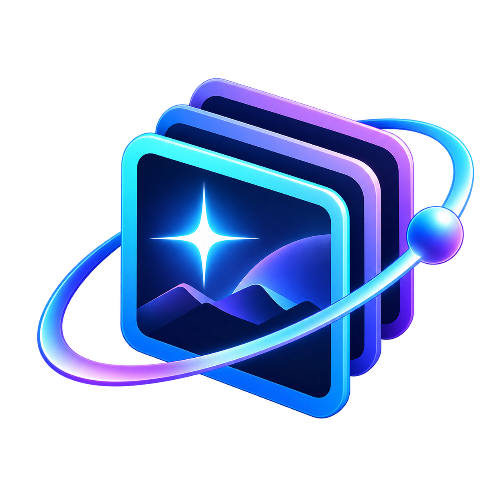
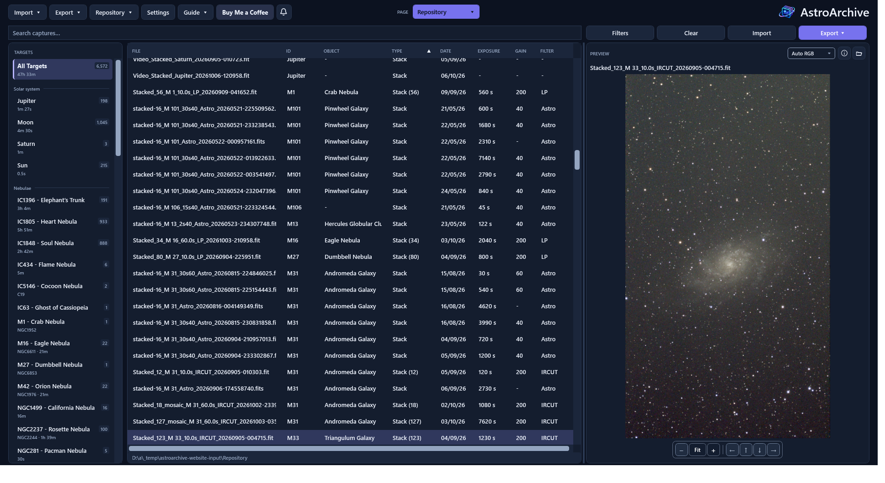
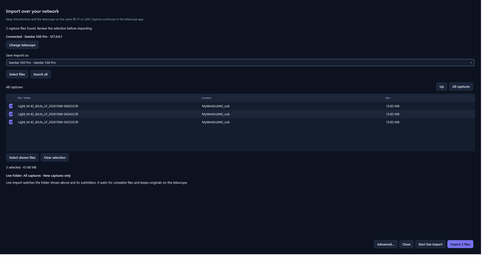
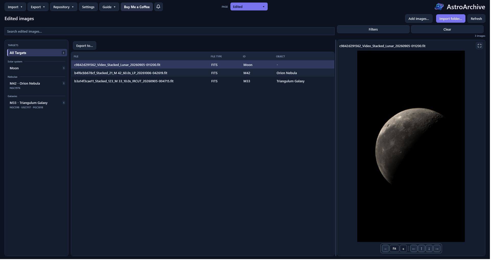

# AstroArchive

### Bring order to your astrophotography.

From a night’s captures to your next processing project.

**[Explore the website](https://astroarchive.arijguest.com)** &nbsp; · &nbsp; **[Read the guide](Application_Source/Quick_Start.txt)** &nbsp; · &nbsp; **[What’s new](https://github.com/arijguest/AstroArchive/releases)**

Windows 10 / 11 x64 &nbsp; · &nbsp; .NET Framework 4.8 &nbsp; · &nbsp; Archive and browse offline

Your nights under the stars, together in one place. Click any screenshot to explore it at full size.

| Keep every session organised | Pick up your next project | See your imaging progress |
| :--- | :--- | :--- |
| Find captures by target, telescope or session instead of digging through folders. | Gather the right files for processing and keep working copies with your archive. | Compare targets, capture history and integration time in Analytics. |

**Explore:** [Import](#bring-the-night-straight-into-your-archive) · [Process](#give-your-next-processing-project-a-head-start) · [Analytics](#see-the-bigger-picture) · [Targets](#know-what-you-captured) · [Get started](#start-with-your-next-session)

## Bring the night straight into your archive

Import from a folder or USB, watch the folder N.I.N.A., SharpCap or ASIAIR saves to,
or connect to **Seestar, DWARF and Celestron Origin over your local network** and
collect captures while the telescope keeps shooting.

Transfers are verified, duplicates are skipped, telescope originals are kept, and
paused or interrupted imports resume where they left off.
[Connection setup and troubleshooting →](docs/REMOTE_IMPORT.md)

## Give your next processing project a head start

Revisit an old favourite or finish last night’s session. Browse previews, choose
your captures, then prepare files for the processing software you already use.

| Find the right captures | Prepare the handoff | Keep the results together |
| :--- | :--- | :--- |
| Search targets and devices, expand grouped subs, and compare stills or recordings. | Export verified originals or compatible stacking folders with optional calibrations and an AstroBin acquisition CSV. | Keep working copies and returned outputs in **Edited**, alongside your archive. |

**Works with your workflow:** PixInsight · Siril · DeepSkyStacker · GIMP · Photoshop · AS!4 · AstroWizard · Stacking Wizard

Stacking and calibration run in your processing software.
[Explore processing handoffs →](docs/PROCESSOR_HANDOFFS.md)

**Star the keepers.** Star, tag and annotate files, sessions or Edited images, and find them again with search and filters.

## See the bigger picture

**Repository → Analytics** charts your targets, imaging timeline and integration
time per target, telescope, filter and exposure length. Export a chart or a full
report as PNG, JPEG, PDF, SVG, MP4 or GIF, or right-click a target to make a
shareable card of your best image of it.

## Know what you captured

Every target gets an offline overview, fun facts and sky position, with optional
downloaded detail and 3D orbits that mark the nights you imaged it. AstroArchive
detects solar and lunar eclipses in your Sun and Moon captures, and **All Targets**
lists upcoming sky events at your observing location.
[Hybrid information guide](docs/HYBRID_INFORMATION.md)

## Find your sharpest subs

**Repository → Review and analysis → Analyse image quality** scores each light frame
from 0 to 100 against its session, then lets you sort, filter and see why a frame
was flagged. Scores only suggest: nothing is rejected for you.
[How scoring works](docs/IMAGE_QUALITY.md)

## Built around the captures you want to keep

**Verified copies. Original bytes. A collection you can return to.**

- Imports and exports preserve image bytes; source originals are kept by default.
- Previews never change your files, and metadata edits only update the index.
- Verified folder or ZIP backups include images, Edited files and the database, copy only what changed, and can run on a schedule.

<strong>Formats and archive care</strong>

| Your files | Support |
| :--- | :--- |
| FITS / gzip FITS / XISF / TIFF / PNG | Scientific previews and eligible explicit FITS conversion |
| JPEG / GIF | Still or animated display; original-file export |
| SER / AVI / MP4 / MOV / M4V / WMV / MKV | Recording previews/playback within format and installed-codec limits |
| CR2 / CR3 / NEF / ARW / DNG | Original-file import/export; previews need a compatible Windows codec |
| Tile-compressed FITS / Zstandard XISF | Optional CFITSIO / Zstandard codecs for decoding |

Keep the whole repository, including `.astroarchive` and `Edited`, together when
moving it. Use one running AstroArchive instance per repository. Network sessions
within that instance coordinate their writes. Choose a separate drive for backups
where possible; optional NTFS **Protect originals** is not a substitute for backup.

[Format limits](docs/COMPATIBILITY.md) · [File and metadata safety](docs/SECURITY.md)

## Start with your next session

1. **[Download and install AstroArchive](https://github.com/arijguest/AstroArchive/releases/latest).** The default Windows installation needs no administrator access.
2. **Choose your archive:** **Settings → General → Choose repository**.
3. **Bring in your captures:** choose a folder and saved physical telescope on **Import**, then scan and review; or choose **Connect over network…**.
4. **Make it yours:** browse **Repository**, prepare an export, or open **Analytics**.

AstroArchive speaks English, Deutsch, Español, Français, Italiano, 日本語 and 简体中文.
It follows your Windows language, or choose one in **Settings → General → Language**.

**Need a hand?** Press **F1** in the app, follow the [offline guide](Application_Source/Quick_Start.txt), or [report an issue](https://github.com/arijguest/AstroArchive/issues).

### What's new in 3.3.2

**[3.3.2](https://github.com/arijguest/AstroArchive/releases/tag/v3.3.2.2)** draws a
solar-cycle corona on the total eclipse sky map, adds upcoming sky events to All
Targets, manages telescope profiles in **Settings → Telescopes** and starts Import
with **Scan folder…**. [All releases →](https://github.com/arijguest/AstroArchive/releases)

## Go further

| Using AstroArchive | Building and contributing |
| :--- | :--- |
| [User guide](Application_Source/Quick_Start.txt) | [Build and focused checks](docs/DEVELOPMENT.md) |
| [Repeat USB and folder imports](docs/FAST_IMPORTS.md) | [Release and signing](docs/RELEASING.md) |
| [Network and live imports](docs/REMOTE_IMPORT.md) | [Licensing and notices](LICENSING.md) |
| [Processing handoffs](docs/PROCESSOR_HANDOFFS.md) | [Report an issue](https://github.com/arijguest/AstroArchive/issues) |
| [Installation and updates](docs/UPDATES.md) | [Website](https://astroarchive.arijguest.com) |

### More time with your images. Less time hunting for them.

**[Download AstroArchive for Windows](https://github.com/arijguest/AstroArchive/releases/latest)**

---

Source-available under [PolyForm Noncommercial 1.0.0](LICENSE). Commercial use
requires separate permission from Ari J. Guest; your images remain yours.

Catalogue data: [OpenNGC](Application_Source/Catalogue_Notice.md) ·
[GeoNames](Application_Source/City_Catalogue_Notice.md) ·
[D3-Celestial](Application_Source/Sky_Catalogue_Notice.md).
Network access: [SMBLibrary](Application_Source/Remote/lib/README.md), bundled as a
separate, replaceable DLL with matching source and licence notices.
Screenshots and photography: [sources and credits](docs/images/README.md).
